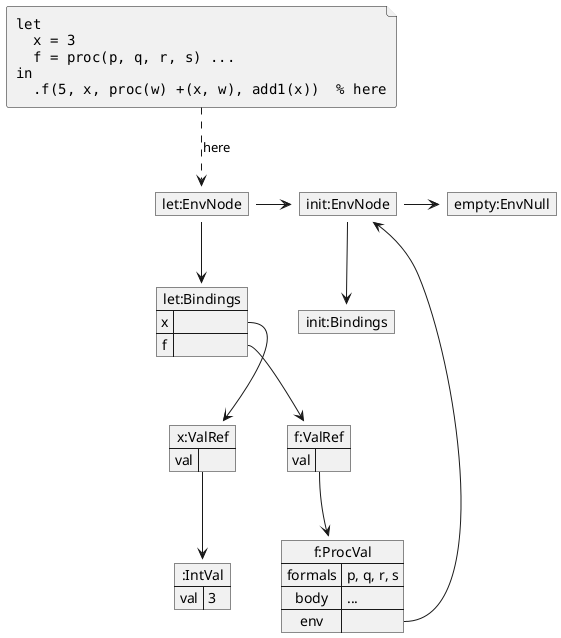
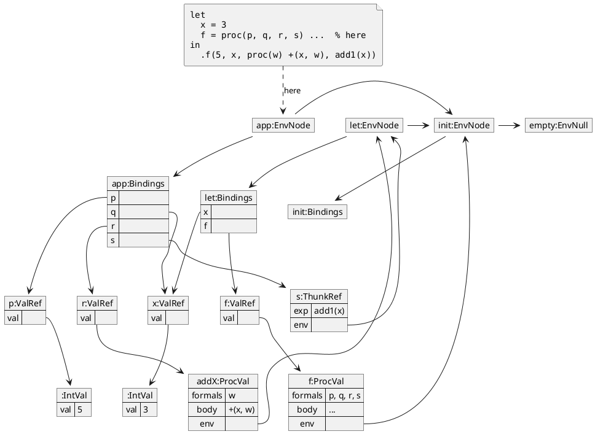

## NAME

### Before `.f(5, x, proc(w) +(x, w), add1(x))`

The state just before the call in the "Illustrations" section. Pairs with "During
`.f(5, x, proc(w) +(x, w), add1(x))`" below.

### During `.f(5, x, proc(w) +(x, w), add1(x))`

