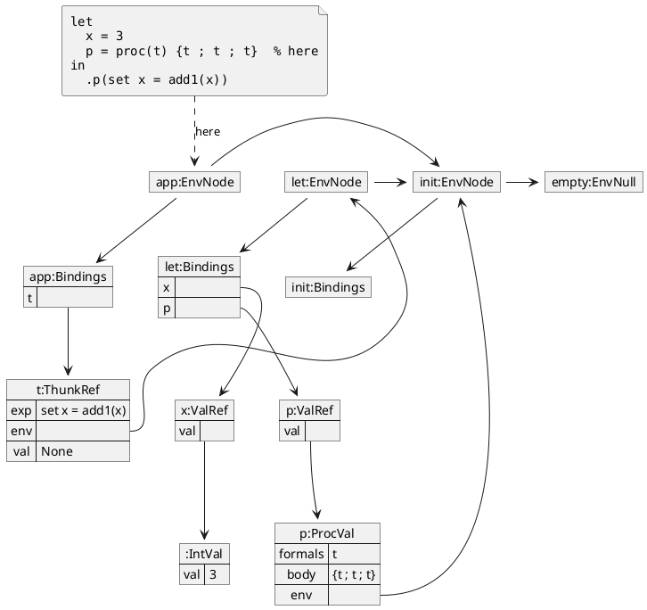
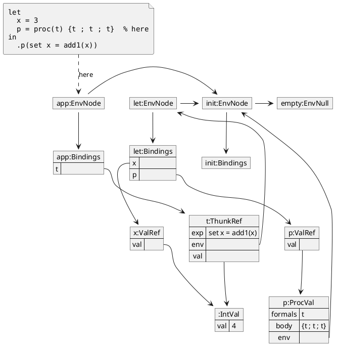
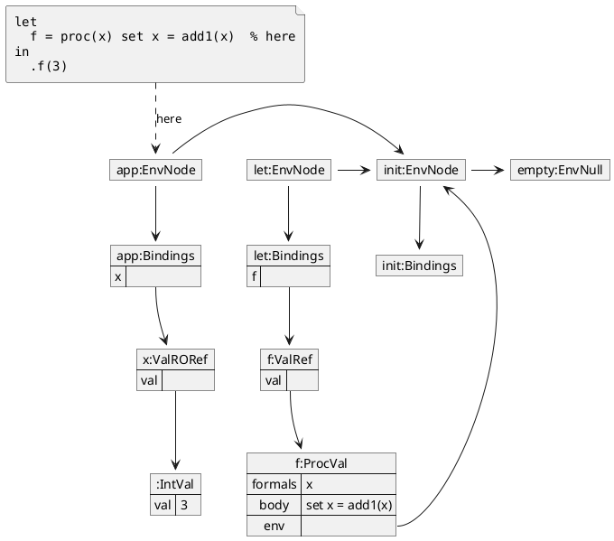

## NEED

New examples. The first two use the program from "Difference between call-by-name
and call-by-need" and show one thunk before and after memoizing.

### During `.p(set x = add1(x))`, before the first `t`

The thunk has not been evaluated, so its `val` is `None` and `x` is still `3`.

### During `.p(set x = add1(x))`, after the first `t`

Evaluating the thunk ran the `set`. `x:ValRef` and the thunk's `val` now point to the
same new `IntVal`, and the `IntVal` holding `3` is no longer reachable. Later
uses of `t` return the memoized value without running the `set` again.

### During `.f(3)`

The "Read only" program. A literal actual parameter is wrapped in a `ValRORef`, so
the `set` in the body raises an error.

