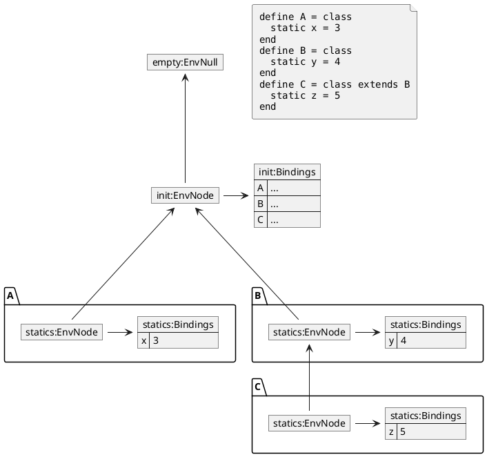
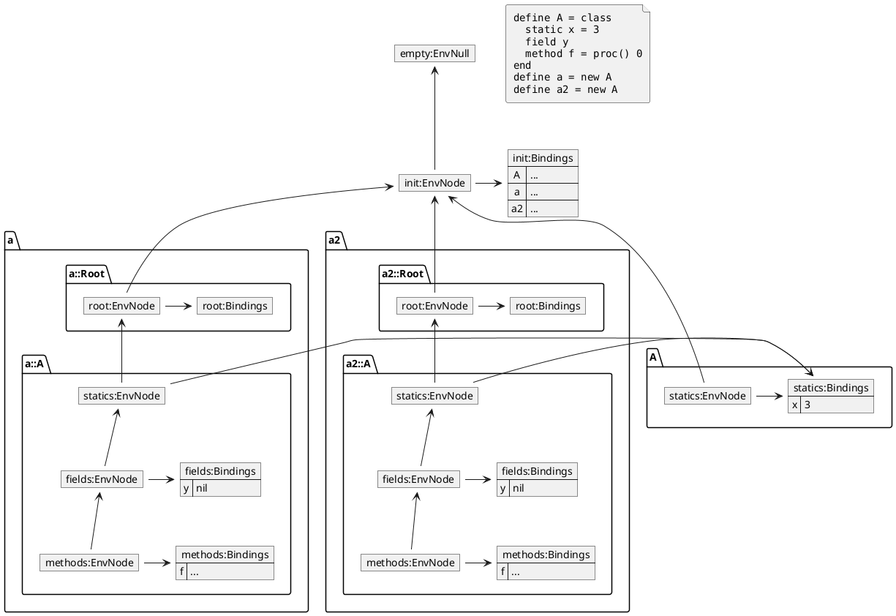
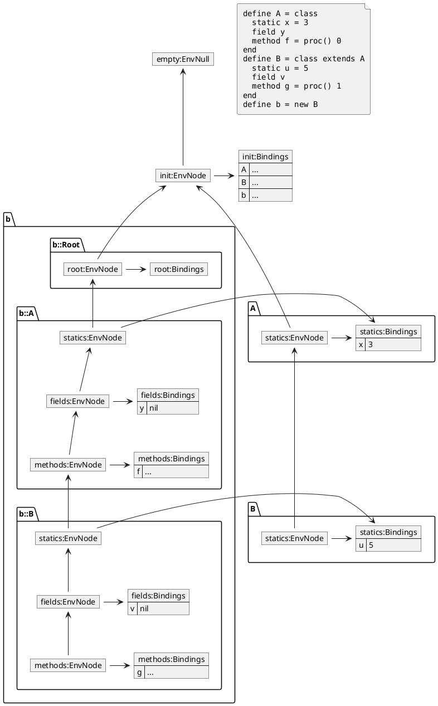
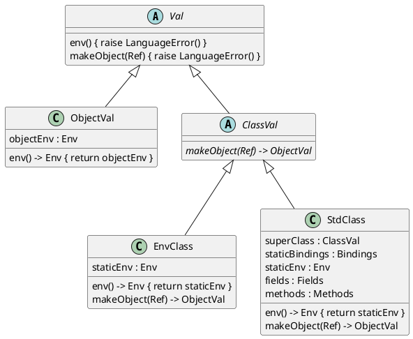
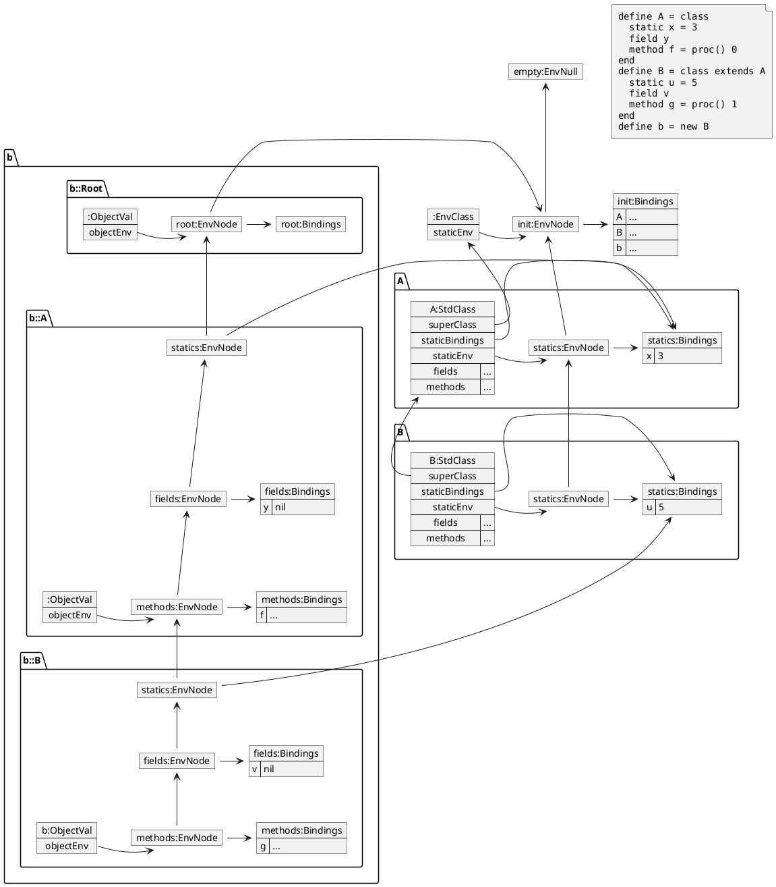
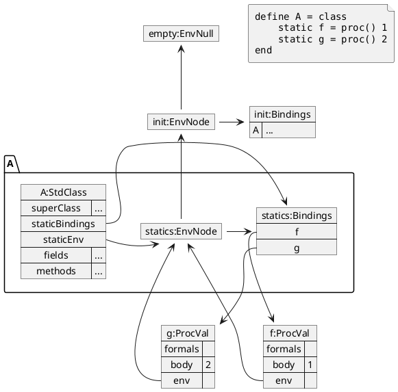
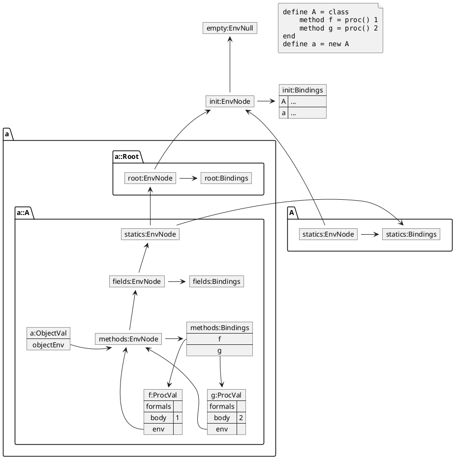
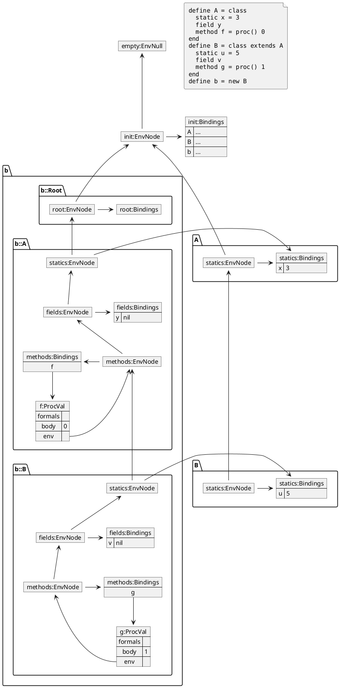
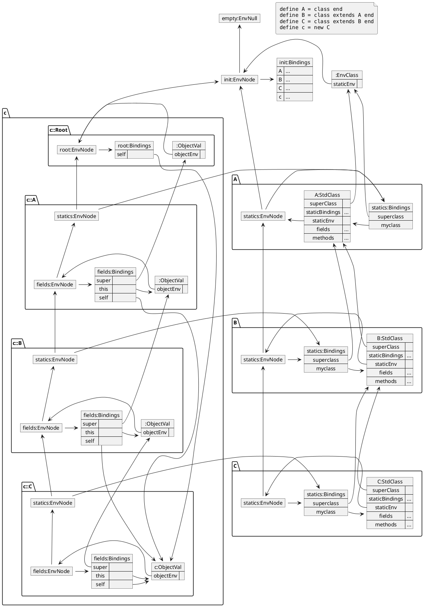

## OBJ

### After `define C`

Each class's static environment extends its superclass's static environment, or
the initial environment if it has no superclass.

### After `define a2`

Each object has its own chain of environments. Its statics environment shares
the class's static bindings, so both objects see the same `x`.

### After `define b`

An object has one part for each class in its chain, plus the root. Each part's
statics environment shares its class's static bindings, so the object's chain
weaves together the statics, fields, and methods of `A` and `B`. The classes
have their own, separate chain.

### The `Val` classes for classes and objects

This is a class diagram of the interpreter, not an environment diagram. In OBJ,
classes and objects are values: a class is a `ClassVal`, and an object is made
of `ObjectVal`s. An `EnvClass` is the root of every class chain, and a
`StdClass` is made by a `class` expression.

### After `define b`, with values

Classes and objects are values that point to environments. A `StdClass` points
to its class's statics environment, and each `ObjectVal` points to the bottom
environment of its part. The environments are the same as in "After `define b`".

### After `define A`, with static `ProcVal`s

A class's statics are evaluated in order when its `class` expression is
evaluated. As in `letrec`, each `ProcVal` captures the environment it is being
added to, here the class's statics environment. So static functions can call
themselves and each other, and can use the statics of superclasses.

### After `define a`, with method `ProcVal`s

Each method's `ProcVal` captures the methods environment of its object's part.
So a method can use that part's methods, including itself, as well as its fields
and statics, and those of the parts above it. It cannot use the names in parts
below it directly.

### After `define b`, with method `ProcVal`s

Each method's `ProcVal` captures the methods environment of its own part. So `g`
can use everything in both parts, but `f` can directly use only what is in
`b::A` and above, even though it is part of the same object as `g`.

### After `define c`, with predefined symbols

The predefined symbols let code reach names that are shadowed in its scope. In
each part of an object, the fields bind `this` to that part, `super` to the part
above, and `self` to the bottom part. The root binds only `self`. In each class,
the statics bind `myclass` to that class and `superclass` to the class above. A
part shares its class's static bindings, so its code sees the same `myclass` and
`superclass`. These classes declare no methods, so their parts have no methods
environments.

