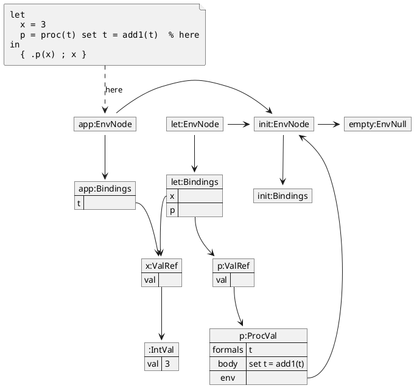
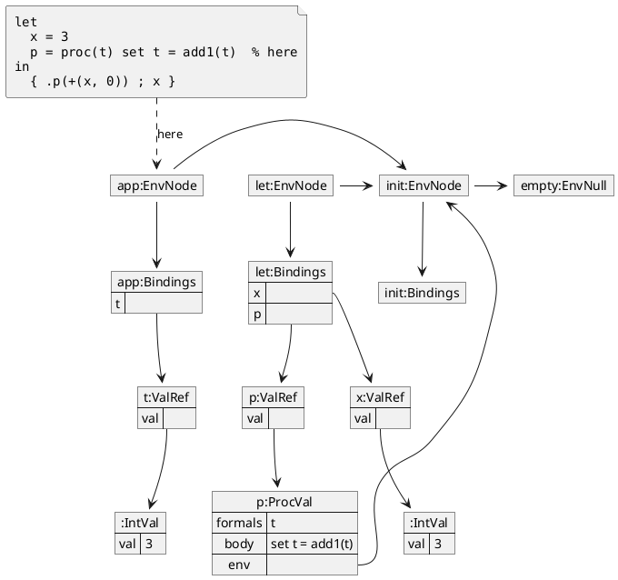

## REF

"During `.p(x)`" here and in `diagrams-set.md` form the call-by-value versus
call-by-reference pair, so they could replace the chapter's two conceptual figures.

### During `.p(x)`

### During `.p(+(x, 0))`

The "L-value versus non-L-value" program. `+(x, 0)` is not a variable, so `t`
gets a new reference holding a new `IntVal`. Two separate `IntVal`s hold `3`.

