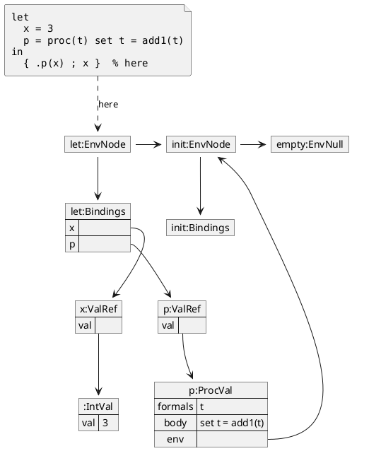
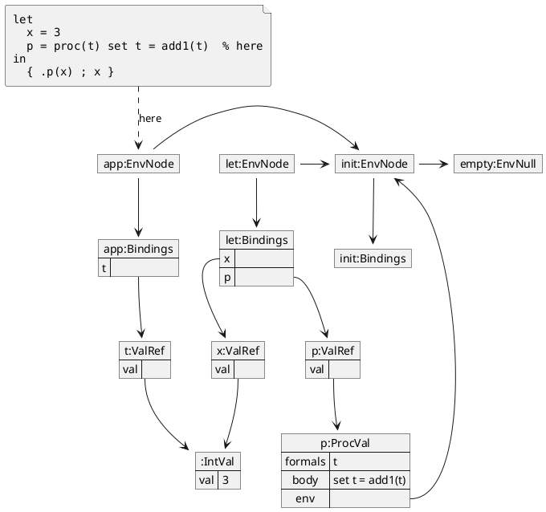
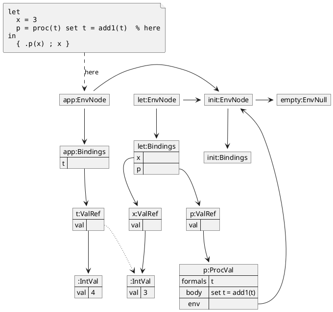
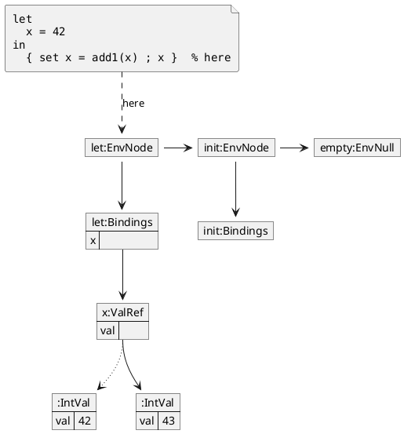
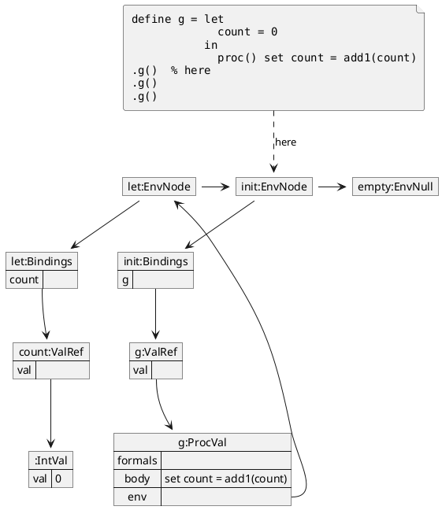
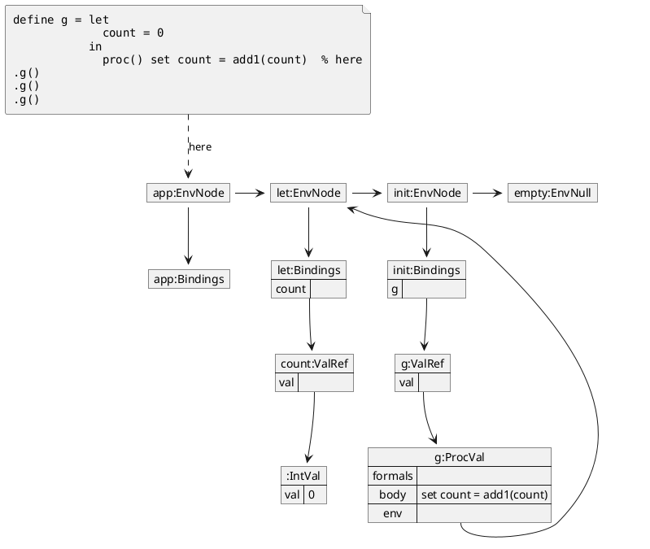

## SET

### Before `.p(x)`

The state before the call in the "Formal parameter" section. Pairs with "During
`.p(x)`" below.

### During `.p(x)`

### After `set t = add1(t)`

`t:ValRef` now holds a new `IntVal`, while `x:ValRef` and its value are untouched. This
is why the program evaluates to `3`. The dotted arrow shows that `t` started with
the same value as `x`.

### After `set x = add1(x)`

The chapter's opening program. The dotted arrow shows where `x` pointed before
the `set`, because the replacement is the point of this diagram.

### After `define g`

The "Environment capture" program. `define` adds `g` to the initial environment,
and the closure keeps `let:EnvNode` alive. The objects form a cycle: `init:EnvNode` reaches
`g:ProcVal` through its bindings, and `g:ProcVal` reaches `init:EnvNode` through `let:EnvNode`.

### During the first `.g()`

The call extends `let:EnvNode` with empty bindings, because `g` has no formal
parameters.

### After the second `.g()`

`count` has persisted between calls. Each call's environment is unreachable once
the call returns, so it is not drawn.

