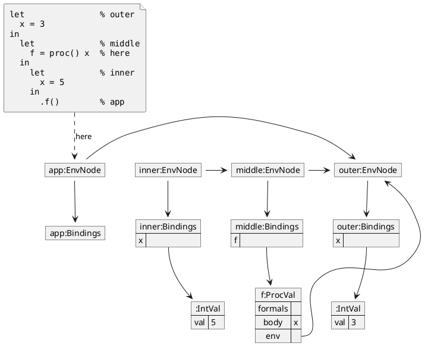

## V4

New example: a closure over a `let`, before references exist. The program is the
static-scoping example from the V4 chapter. The call extends the closure's
captured environment (`outer:EnvNode`), not the calling environment (`inner:EnvNode`), so
`x` resolves to `3`. `init` and `empty` are left out to reduce crowding, and the
chain continues past `outer:EnvNode`.

### During `.f()`

