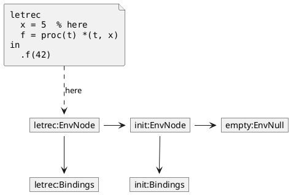
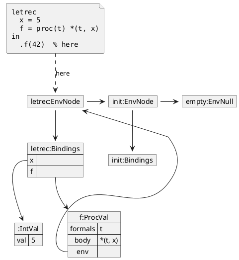
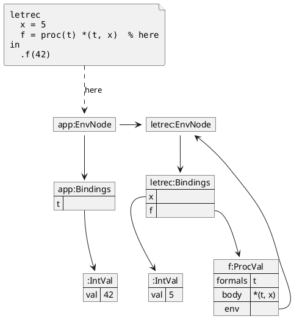

## V5

### Before evaluating the right-hand side of `x`

### Before `.f(42)`

### During `.f(42)`

`init` and `empty` are left out to reduce crowding, and the chain continues past
`letrec:EnvNode`.

