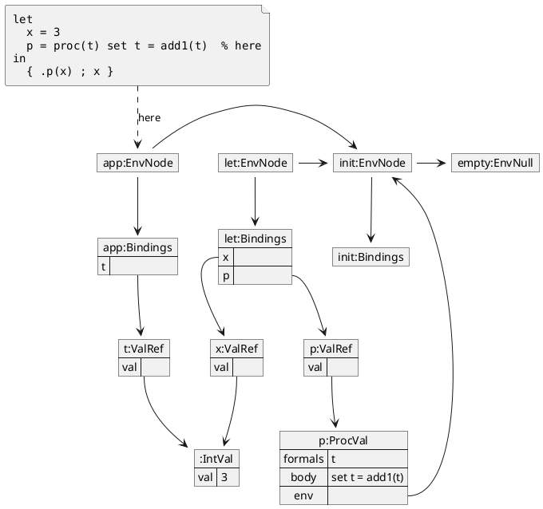

# Environment diagram style guide

This guide is for authors drawing environment diagrams in PlantUML for the
textbook. It extends the textbook's general style guide (**style-guide.md** at
the root of this repository).

Authors should follow these guidelines to produce consistent, readable diagrams.
They may need to depart from the defaults when PlantUML's layout algorithm
produces a poor layout, and we describe adjustments to try. What a diagram
includes depends on its purpose.

The **diagrams-*.md** files in this directory hold worked examples for Languages
`V3`, `V4`, `V5`, `SET`, `REF`, `NAME`, and `NEED`.

## A complete example

This diagram shows a `SET` program during the call `.p(x)`.



Reading it from the top:

* The source box holds the program, and `% here` marks the line being evaluated.
* The dashed `here` arrow points to the current environment.
* Below the source box, the environments sit side by side, linked by chain
  arrows, and each has its bindings below it.
* Each variable's binding leads to a reference, and each reference to a value.
* `x` and `t` have separate references that share one `IntVal`.
* The closure, `p:ProcVal`, has an `env` row that points back to the environment
  it captured. A `let` evaluates its right-hand sides in the enclosing
  environment, so that is `init:EnvNode`, not `let:EnvNode`.

## What a diagram shows

A diagram is a snapshot of the interpreter at one moment during evaluation.
Apart from the source box and its `here` arrow, each box is one runtime object,
and each arrow, or *edge*, is one pointer. A *row* is one line inside a box,
such as `val`. To decide what to draw, trace the code and draw what it creates.
Two boxes that hold equal values stay separate, so authors do not need to judge
what is equal enough to merge.

The following simplifications leave detail out, but do not change which objects
exist or what they point to:

* `Bindings` rows stand in for the `Binding` objects in its `bindingList`.
* `formals`, `body`, and `exp` show source text, not `Formals` or `Exp` objects.
* `IntVal` shows its integer inline.
* `EnvNode` has no rows. Its `env` and `bindings` attributes are unlabeled
  edges.

Some boxes have specific rows:

* `ProcVal` has `formals`, `body`, and `env` rows. A function with no parameters
  has a blank `formals` row, with no arrow leaving it.
* `ThunkRef` has `exp` and `env` rows. In `NEED`, it also has a `val` row, which
  shows `None` before evaluation and has an arrow to the result afterward.

### What the code creates

Check these against the language being drawn, because they are easy to get
wrong:

| Situation | What to draw |
|---|---|
| Any program | `init:EnvNode` with empty `Bindings`, extending `EnvNull` |
| `define` | A binding added to the initial environment |
| `let` | A new environment extending the enclosing one, with right-hand sides evaluated in the enclosing one |
| `letrec` | A new environment, with right-hand sides evaluated in that new environment |
| `proc` | A new `ProcVal`, or *closure*, whose `env` points to the environment where the `proc` was evaluated |
| A function call | A new environment extending the closure's `env`, not the caller's |
| Primitive such as `+` or `add1` | A new `IntVal` |
| A variable used as a value | The same value object the variable is bound to, not a copy |

Parameter passing differs by language:

| Actual parameter | `V4` to `V6` | `SET` | `REF` | `NAME` | `NEED` |
|---|---|---|---|---|---|
| Variable | The value | New `ValRef` | Same reference | Same reference | Same reference |
| Literal or `proc` | The value | New `ValRef` | New `ValRef` | New `ValRef` | New `ValRORef` |
| Other expression | The value | New `ValRef` | New `ValRef` | New `ThunkRef` | New `ThunkRef` |

## Declaring the diagram

Start with `skinparam fileFontName monospaced`, which keeps the program's
alignment in the source box. Then declare things in this order. We call items 2
to 5 *groups*, and their order also decides the form of each arrow (see "Drawing
arrows"):

1. `file source [ ... ]`
2. `'Environments`: `empty_EnvNull`, then `init_EnvNode`, then the rest in
   creation order
3. `'Bindings`: in the same order as the environments
4. `'References`: from `SET` onward
5. `'Values`
6. `'Edges`

Wrap each group in `together { }`, and leave out any group with no members.

## Naming boxes

Names follow UML object notation, where `name:Type` is a named object and
`:Type` is an anonymous one. A box's alias, which appears only in the PlantUML
source, is `<name>_<Type>`, and its label is `<name>:<Type>` unless the name
adds nothing. `<Type>` is the object's runtime class, not a superclass.

| Object | `<name>` | Label | Alias |
|---|---|---|---|
| Integer | Its value | `:IntVal` | `3_IntVal` |
| Another integer with the same value | Its value plus a letter, such as `3b` | `:IntVal` | `3b_IntVal` |
| Function bound to a variable | The first variable bound to it | `f:ProcVal` | `f_ProcVal` |
| Anonymous function | What it does | `double:ProcVal` | `double_ProcVal` |
| Reference | The first variable bound to it | `x:ValRef` | `x_ValRef` |
| Environment | Its scope | `let:EnvNode` | `let_EnvNode` |
| Bindings | Its scope | `let:Bindings` | `let_Bindings` |
| Object named for a variable that appears in several scopes | Scope, then variable | `outer_x:ValRef` | `outer_x_ValRef` |

An environment's *scope* is a short name for what created it: `let`, `letrec`,
or `app` for a function call. `init` and `empty` exist before the program runs.
When two environments would share a name, choose names that tell them apart,
such as `outer` and `inner`, and tie them to the code with `% <scope>` markers
(see "Showing where evaluation is"). For several live calls, as in recursion,
choose names such as `app1` and `app2`.

Integers are anonymous because the value already appears in the `val` row.

We do not underline names, which UML allows when a diagram clearly shows
instances.

## Titling a diagram

Give each diagram a heading that names the moment shown, such as "Before
`.p(x)`", "During `.p(x)`", or "After `set t = add1(t)`".

## Drawing arrows

The order of the groups decides the form of the arrow:

| Edge | Form | Example |
|---|---|---|
| Within a group (the environment chain) | `->` | `app_EnvNode -> init_EnvNode` |
| To a later group | `-->` | `let_Bindings::x --> x_ValRef` |
| To an earlier group | `<--`, with the target on the left | `let_EnvNode <-- f_ProcVal::env` |
| Source to current environment | `..>` | `source ..> app_EnvNode : here` |

We call an arrow to an earlier group a *back-edge*. Writing it with `<--`
matters because of our working belief, which we have not verified, that the
layout engine weighs edge directions. Too many back-edges written with `-->` can
turn the whole diagram around.

## Showing where evaluation is

Copy the program's code from the chapter exactly. The only additions are `%`
comments, which are valid in these languages. Align them in one column.

To mark the line being evaluated, add the *marker* `% here`. During a call, mark
the `proc` whose body is being evaluated.

By default, draw an arrow from the source box to the current environment:

```plantuml
source ..> app_EnvNode : here
```

The marker gives the location in the code, and the arrow shows which environment
is active. This matters most during a call, because `% here` marks the `proc`,
not the call's environment.

To tie an environment to its code, add `% <scope>` to the line that creates it.
This is needed only when the environment's name alone does not identify that
line. For example:

```
let          % outer
  x = 3
in
  let        % inner
    x = add1(x)
  in
    +(x, x)  % here
```

A lone `let` or `letrec` does not need a marker, and neither do `init` and
`empty`, since no code in the program creates them.

Recursion can create several live environments from one line. A marker cannot
separate them, so use the caption or the surrounding prose.

## Showing that something was replaced

Show a replacement when it is the point of the diagram. Otherwise, leave out old
arrows and unreachable objects. To show one, keep the old box and draw the old
arrow dotted:

```plantuml
x_ValRef::val --> 43_IntVal
x_ValRef::val -[dotted]-> 42_IntVal
```

The old object may be abandoned or still held by something else, as in "After
`set t = add1(t)`" in **diagrams-set.md**.

In the `count` program in **diagrams-set.md**, the old values are left out,
because the point is that `count` persists.

## Simplifying a crowded diagram

By default, draw `empty:EnvNull`, `init:EnvNode`, and `init:Bindings`. Leave
them out when the diagram's purpose does not involve them, removing all three
boxes and their edges together.

Leaving them out is a shorthand. The chain still continues past the last box
shown, so say so in the caption or surrounding prose. Removing them can also put
the remaining environments in order, as it did for `V4` "During `.f()`" and `V5`
"During `.f(42)`".

Keep them when the diagram needs the initial environment, as when `define` has
added bindings to it.

## Putting the environments in order

The layout engine sometimes puts the environments out of order, even where a
better order is available. We have not found a way to predict this. Try these in
turn. Neither is guaranteed, and which one helps varies by diagram.

1. Change the back-edges to `<-[norank]-`, such as
   `let_EnvNode <-[norank]- f_ProcVal::env`. This can put them in order, but the
   arrows may take odd routes. It fixed `SET` "During the first `.g()`" and `V5`
   "Before `.f(42)`", and it made `NAME` "During" worse.
2. Remove `empty:EnvNull`, `init:EnvNode`, and `init:Bindings`. See "Simplifying
   a crowded diagram".

Changing the order of declarations and removing `together` from the environments
had no effect in our tests.

## Avoiding PlantUML pitfalls

| Problem | Symptom | What to do |
|---|---|---|
| `?` in an alias | Syntax error | Drop `?` from the variable's name in all boxes except the source box |
| `?` in a row with an arrow | No error, but missing arrows and stray boxes | Same |
| A row value starting with `*` | It displays as a bullet | Write `~*`, such as `body => ~*(t, x)` |

The source box keeps the program exactly as written, including any `?`. A `*` in
the middle of a value is fine, and `+`, `-`, `/`, `{ }`, and `...` display
correctly. We have not tested a source line that starts with `*`.

## Notes for a future generator

A `plcc-ng` feature could produce these diagrams. Most of this guide is
mechanical, but some names need information the interpreter does not have today:

* An anonymous function's name describes what it does, so a generator needs a
  fallback such as `proc1_ProcVal`.
* An `EnvNode` does not record what created it, so scope names such as `let` and
  `app` need tracking or a fallback.
* Naming by the first variable bound requires knowing the order of bindings,
  which may need tracking over time.

A generator should also leave out abandoned objects by default, offer a setting
to include them, and apply the `~*` escape automatically.
