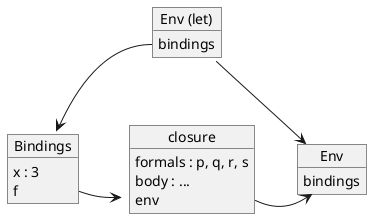
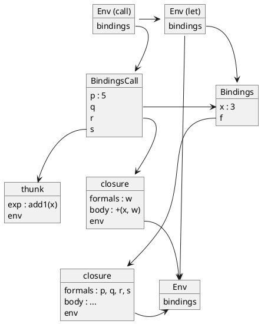

# Language NAME

We now turn to a different parameter passing mechanism, *call-by-name*. In
call-by-name function application, we bind each function's formal parameter to
its corresponding *un-evaluated actual parameter expression*. Each time we
reference a formal parameter in the function body, we evaluate its corresponding
actual parameter expression *in the environment where the function was called*,
that is, the *calling environment*, and this value becomes the expressed value
of the formal parameter.

With such a parameter passing convention, the following program

```
let
  x = 1
  f = proc(t, u) {
    set t = add1(t) ;
    u
  }
in
  .f(x, +(x, 5))
```

evaluates to `7`.

## A quick tour

When we evaluate `.f(x, +(x, 5))` in the previous program using call-by-name,
the formal parameter `t` still denotes the same reference that `x` denotes
(initially containing `1`), but the formal parameter `u` denotes the
(un-evaluated) expression `+(x, 5)`.

The set operation in the body of function `f` increments the formal parameter
`t`; but since `t` denotes the same reference as `x`, the value of `x` changes
too, to `2`. When we then evaluate the formal parameter `u` at the end of the
`proc` body, we evaluate the expression `+(x, 5)` denoted by `u` in the
*environment of the caller*. Since this expression gets evaluated after the
`set`, and the value of `x` is now `2` the value of the expression `+(x, 5)`
(and thus the value returned by the function application) is `+(2, 5)` or `7`.
Thus the entire expression evaluates to `7`.

In call-by-reference (introduced in the previous chapter), when we evaluate the
same function call `.f(x, +(x,5))`, the formal parameter `t` in the definition
of `f` denotes the same reference that `x` denotes (initially containing `1`),
whereas the formal parameter `u` denotes a new reference to the value `6`.
Modifying `t` in the body of `f` changes the expressed value of `x` (because `t`
and `x` denote the same reference) but does not change the expressed value of
`u`. Thus this expression evaluates to `6`.

In summary, in the presence of side-effects, call-by-reference and call-by-name
may give different results.

## Call-by-name

Call-by-name has behaviors that differ from call-by-reference:

1. If we never reference the formal parameter in the function body, we never
   evaluate the actual parameter expression; and

2. Every time we evaluate the formal parameter in the function body, we
   re-evaluate the actual parameter expression.

Two actual parameter expressions that can appear in function applications have
*constant behavior*: They are `LitExp` and `ProcExp`. Evaluating these
expressions do not produce any side-effects, and their expressed values can
never change. (Don't confuse *evaluating* a function expression with *applying*
such an expression.) Because of this observation, in call-by-name we can
evaluate these actual parameter expressions directly during function application
and can bind their corresponding formal parameters to new references to their
values directly. In other words, we use *value* semantics for these actual
parameter expressions.

Evaluating variables that appear as actual parameter expressions (`VarExp`) also
do not produce any side-effects, but such variables may have denoted values that
can change. We therefore use *reference* semantics for actual parameter
expressions that are variables.

## While loop

Consider the following definition:

```
define while = proc(test?, do, ans)
  letrec loop = proc()
    if test? then { do ; .loop() } else ans
  in .loop()
```

Using call-by-name, the expression

```
let x = 0 sum = 0 in
  .while(
    .proc(x) -(11, x) (x),
    { set sum = +(sum, *(x, x)) ; set x = add1(x) },
    sum
  )
```

returns the sum

$\sum_{x = 1}^{10} x^2 = 385$

Using call-by-reference as in the language `REF`, the expression never
terminates because the actual parameter expression `.proc(x) -(11, x) (x)` is
evaluated only once, to `11` (true) when `x` is initially `0`, and so the
`test?` parameter is bound permanently to (a reference to) `11`. Evaluating
`test?` repeatedly always returns `11` (true), so the "loop" never terminates.
(Running this example with the Python-based specification ends abnormally with
the error message `maximum recursion depth exceeded`, rather than executing
endlessly.)

## Thunk

We proceed to implement call-by-name. We take our call-by-reference (i.e.,
`REF`) implementation as a starting point.

If an actual parameter is a literal expression (such as `4`), we bind the formal
parameter to (a reference to) the literal value. If an actual parameter is a
function, we bind the formal parameter to (a reference to) the function's
closure in the calling environment. If an actual parameter is an identifier, we
bind the formal parameter to the same reference as the actual parameter, using
reference semantics.

If an actual parameter is any other kind of expression, we bind the formal
parameter to a `Ref` object that captures the expression in the environment in
which it was called and that can be evaluated, when needed, by the called
function. We call such an object a *thunk*.

A thunk amounts to a parameterless function that consists of an expression and
an environment in which the expression is to be evaluated. It looks just like a
closure, except that there is no formal parameter list.

```python
class ThunkRef(Ref):

    def __init__(self, exp, env):
        self.exp = exp
        self.env = env
```

A `ThunkRef` is a `Ref`, since we want to de-reference (`deRef`) it whenever we
refer to the corresponding actual parameter. We bind a formal parameter to a
thunk reference only during function application. Thunks will otherwise not play
a role in expression semantics.

To change from call-by-reference to call-by-name, we need to change the default
`evalRef` behavior of the Exp objects so that `evalRef` returns a thunk for most
expressions *except* for `LitExp`, `ProcExp`, and `VarExp`. This means that we
define `evalRef` in the `Exp` class with its default behavior as follows: 

```python
    def evalRef(self, env):
        return ThunkRef(env)
```

For a `LitExp` and a `ProcExp`, a thunk is not necessary, so we return an
ordinary `ValRef` as in the `REF` language:

```python
    def evalRef(self, env):
        return ValRef(self.eval(env))
```

Finally, for a `VarExp`, we simply use reference semantics as in the `REF`
language:

```python
    def evalRef(self, env):
        return env.applyEnvRef(self.symbol.lexeme)
```

The `ThunkRef` class is straight-forward:

```
ThunkRef
%%%
class ThunkRef(Ref)

    def __init__(self, exp, env):
        self.exp = exp
        self.env = env

    def deRef(self):
        return self.exp.eval(self.env);

    def setRef(Val v):
        raise LanguageError("cannot modify a read-only expression")        
```

Observe that the `setRef` method raises an exception. This method is only used
to evaluate `set` expressions, and it doesn't make sense to have something other
than a `VarExp` on the left-hand side of a `set`.

## Illustrations

Consider the following program excerpt to help you understand how these bindings
work.

```
let
  x = 3
  f = proc(p, q, r, s) ...
in
  .f(5, x, proc(w) +(x, w), add1(x))
```

The hypothetical function `f` is defined in the declarations of the `let`
expression. It take four arguments (`p`, `q`, `r`, and `s`). The body of the
function is not relevant for this discussion and therefore left unspecified
(`...`). The body of the `let` expression calls this function with the four
possible cases: literal, variable, function, and other.

The following drawing shows an environment diagram corresponding to the state
of evaluation just prior to invoking the function `f`. It shows the two bindings
associated with the environment created by the `let` expression: a binding
associating variable `x` with a reference to value `3` and a binding associating
variable `f` to its closure.



The next drawing shows an environment diagram corresponding to the state of
evaluation during the invocation of function `f`. Parameter `p` is bound to a
reference to value `5`; parameter `q` is bound to the same reference as variable
`x` in the `let` declarations; parameter `r` is bound to a closure; and,
finally, parameter `s` is bound to a thunk capturing the expression `add1(x)`.



## Going beyond

In the presence of side-effects, call-by-name has interesting properties that
make it very powerful but often difficult to reason about. The language ALGOL 60
had call-by-value and call-by-name as its parameter passing mechanisms. ALGOL 60
had its greatest influence on languages such as Pascal, C/C++, and Java.
Although call-by-name has been all but abandoned by modern imperative
(side-effecting) programming languages - mostly because of its inefficiency, it
still plays a role in functional programming: Scheme supports a variant,
*call-by-need*, by means of `promise/force`; Haskell also supports call-by-need,
which we cover in the next chapter.
